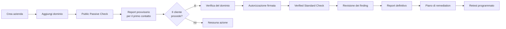

# Runbook operativo

Procedure per chi conduce le valutazioni e per chi gestisce la piattaforma.

## 1. Nuova azienda: dal contatto al report



### 1.1 Pre-sales (senza autorizzazione)

1. creare l'azienda con ragione sociale e dominio principale;
2. avviare un **Public Passive Check**;
3. attendere il completamento (dashboard → Scansioni);
4. generare un report **non definitivo** (`is_final: false`);
5. presentare il risultato **dichiarando la confidence**.

Se la confidence e' sotto il 50%, il report riporta «Valutazione provvisoria».
Non presentarlo come rating definitivo: e' scorretto e indebolisce la
credibilita' del servizio.

### 1.2 Valutazione autorizzata

1. verificare il dominio (DNS TXT o file HTTP);
2. registrare l'autorizzazione con soggetto autorizzante, perimetro, profili
   concessi, scadenza ed esclusioni;
3. registrare gli IP e le reti autorizzate;
4. controllare l'anteprima: `GET /companies/{id}/scans/authorization-preview`;
5. avviare il **Verified Standard Check**;
6. rivedere tutti i finding critici e alti;
7. generare il report definitivo (`is_final: true`);
8. far approvare il report da un Reviewer.

## 2. Revisione dei finding

Un report definitivo **non e' emettibile** finche' restano finding critici o
alti non validati. E' una scelta deliberata: un rilievo automatico che
azzera il rating di un cliente deve essere guardato da una persona.

| Azione | Quando usarla | Motivazione |
|---|---|---|
| Conferma | il rilievo e' reale | non richiesta |
| Falso positivo | il rilievo non sussiste | **obbligatoria** |
| Accetta il rischio | reale ma accettato dal cliente | **obbligatoria** |
| Escludi dal rating | reale ma fuori perimetro | **obbligatoria** |
| Richiedi retest | da verificare dopo la correzione | non richiesta |

Ogni azione e' registrata nell'audit log con stato precedente e successivo.

### Cosa guardare in un finding critico

1. l'asset e' davvero del cliente? (`ownership_status`)
2. l'evidenza e' confermata o probabile?
3. per una CVE: la versione e' nota e nel range vulnerabile?
4. per un rilievo dark web: la corrispondenza del nome e' forte?
5. il rilievo attiva un rating cap? in tal caso la validazione ha effetto
   diretto sul punteggio finale.

## 3. Diagnostica

### Prima di qualunque altra cosa: che cosa e' utilizzabile

```bash
make strumenti                   # elenco completo, con il rimedio per ciascuno
make strumenti DA_SISTEMARE=1    # solo cio' su cui c'e' qualcosa da fare
```

Risponde alla domanda «perche' tanti strumenti non vengono eseguiti» senza
dover lanciare una scansione e leggere la matrice di copertura a cose fatte.
Per ogni strumento del catalogo dice in quale dei sette stati si trova:

| Esito | Significato | Rimedio |
|---|---|---|
| `operativo` | presente, configurato, e il servizio risponde | nessuno |
| `alias` | la voce non e' un'esecuzione a se': in scansione quella chiave esegue un altro strumento (`nmap` esegue naabu, `epss` esegue kev) | nessuno |
| `su richiesta` | pronto, ma aspetta qualcosa (un'intestazione da incollare, domini verificati, indirizzi e-mail individuati) | nessuno: non e' un guasto |
| `non distribuito` | assente per scelta, tipicamente una licenza che non consente la redistribuzione | nessuno: `make aggiorna` non lo farebbe comparire |
| `sostituito` | assente o non configurato, e la sua area la copre un altro strumento | nessuno |
| `a pagamento` | richiede un abbonamento che non c'e' | si acquista, o si rinuncia all'area |
| `da configurare` | manca una variabile | Personalizzazione -> Strumenti, oppure `.env` |
| `non raggiungibile` | l'indirizzo c'e', il servizio non risponde | il comando che lo avvia, stampato accanto |
| `binario assente` | manca dall'immagine del worker | `make aggiorna` |

Un indirizzo di loopback (`127.0.0.1`, `localhost`) in una variabile di
servizio e' l'errore piu' facile da commettere e il piu' difficile da vedere:
dentro il contenitore quell'indirizzo e' il contenitore stesso, non la macchina
che lo ospita, e il sistema operativo risponde `connection refused` — lo stesso
messaggio che si otterrebbe se il servizio non fosse mai partito. Per un
servizio avviato sulla macchina serve `http://host.docker.internal:<porta>`
(Docker Desktop su macOS e Windows); per uno del compose, il nome del servizio.
Il comando lo riconosce e lo dice.

Va eseguito nel worker, ed e' cio' che fa il target: i binari stanno nella sua
immagine e i servizi facoltativi rispondono sulla rete interna. Eseguito
nell'API ogni binario risulterebbe assente -- correttamente, perche' per
scelta li' non ci sono.

La verifica apre connessioni soltanto verso i servizi che ospita chi installa
(theHarvester, ZAP, e SpiderFoot per chi ne ospita uno), con un `connect`
TCP che chiude subito: nessun
bersaglio di scansione entra nel comando, e le fonti commerciali non vengono
contattate. `--senza-rete` salta anche quelle.

### Il report: due documenti, e cosa si manda

```bash
# dall'API: "report_type": "split"
# dalla riga di comando:
make report-demo                   # un documento unito, come prima
docker compose exec api python -m app.cli report-demo --separati
```

Con `split` ogni formato produce **due** file:

| File | Contenuto | A chi |
|---|---|---|
| `...-direzione.pdf` | risultato, perimetro, elementi analizzati, cosa fare | si manda al cliente |
| `...-allegato-tecnico.pdf` | rilievi con indirizzi e versioni, inventario completo, piano di rimedio | si decide volta per volta |

L'allegato contiene indirizzi, versioni dei prodotti e dettaglio dei rilievi:
finche' le due parti erano un unico file, la scelta non esisteva. JSON e CSV non
si dividono: sono un'unica rappresentazione dei dati.

Il rapporto per la direzione include la tabella **degli elementi analizzati**,
per tipo, con quelli di terze parti dichiarati a parte. Risponde alla domanda
che precede ogni numero -- «che cosa avete guardato?» -- e la risposta non e'
nei conteggi: un punteggio alto su tre nomi e lo stesso su duecento sono
affermazioni molto diverse. Oltre dodici nomi per tipo si dichiara il totale.

### Configurare gli strumenti che ne hanno bisogno

Sono quattro, e solo due dipendono da noi.

| Strumento | Cosa serve | Come |
|---|---|---|
| theHarvester | `THEHARVESTER_URL=http://theharvester:5000` | profilo `osint` (gia' predefinito) |
| SpiderFoot | `SPIDERFOOT_URL=http://spiderfoot:5001` | profilo `osint`; l'immagine la costruisce `make build` |
| OWASP ZAP | `ZAP_API_KEY` (la scegli tu) + `ZAP_URL=http://zap:8090` | `openssl rand -hex 24`, poi `make up-zap` |
| HIBP, credenziali esposte | un abbonamento | niente da configurare senza |

I due del profilo `osint` sono gratuiti, locali e senza chiavi: basta che
`COMPOSE_PROFILES=osint` sia in `.env` e che i due indirizzi siano quelli qui
sopra. ZAP ha una chiave che **sceglie chi installa**, non un fornitore: la
stessa deve comparire in `.env` e nel comando del servizio, e `make up-zap`
rifiuta di partire se manca.

#### Attenzione: `.env` o interfaccia, non entrambi

Il database ha la **precedenza** su `.env`. Un valore salvato una volta da
Personalizzazione -> Strumenti resta in vigore per sempre, e **ogni modifica a
`.env` diventa inefficace**, senza che nulla lo dica. E' la trappola piu'
costosa della configurazione, perche' il sintomo e' indistinguibile da una
modifica non applicata: si corregge il file, si riavvia, l'errore e' identico.

`make strumenti` ora dichiara l'origine di ogni valore:

```
spiderfoot   non raggiungibile   SPIDERFOOT_URL=http://127.0.0.1:5001/ (da interfaccia): ...
   -> SPIDERFOOT_URL e' salvata nel database e ha la PRECEDENZA su .env:
      modificare .env non ha effetto.
```

Per far tornare valido `.env`, senza passare dall'interfaccia:

```bash
docker compose run --rm api python -m app.cli strumenti --dimentica SPIDERFOOT_URL
make up
```

Accetta solo le variabili dell'elenco chiuso, le stesse che l'interfaccia puo'
scrivere: e' la stessa difesa, nell'altra direzione.

#### `theHarvester non raggiungibile: Name or service not known`

E' diverso da «connection refused», e il rimedio e' un altro. Qui il nome
`theharvester` non si risolve: il contenitore **non esiste**, quindi Docker non
ha un indirizzo da dargli. Il profilo `osint` non e' attivo, o il servizio non
e' partito.

```bash
docker compose ps theharvester     # c'e'?
make up-osint                      # lo avvia
```

`connection refused` sarebbe il contrario: il contenitore c'e' e nessuno
ascolta su quella porta.

#### Le fonti pubbliche cedono, e non e' un guasto della piattaforma

| Messaggio | Cosa significa |
|---|---|
| `crt.sh: 502 Bad Gateway` | crt.sh e' sotto carico. Dalla 0.18.12 la richiesta viene ritentata una volta e il piu' delle volte passa; se compare ancora, crt.sh e' giu' per tutti |
| `catalogo CISA KEV da cache: copia di N ore fa` | il feed non si e' raggiunto e si sta usando la copia su disco. L'esito e' `PARTIAL`, non un guasto: il catalogo CISA cambia di qualche voce la settimana |
| `feed CISA KEV non disponibile (<url>): ConnectError: ...` | nessuna copia disponibile e feed irraggiungibile. Questo e' da guardare: il worker esce su Internet? il DNS risolve `www.cisa.gov`? |

Il ritentativo vale per le **fonti** (crt.sh, i feed CISA), non per i bersagli
di una scansione: la' ritentare raddoppierebbe il traffico verso i sistemi di
un'azienda. Un 404 e un 429 non si ritentano mai -- il primo e' una risposta
legittima, il secondo e' la fonte che chiede di rallentare.

La cache dei feed sta sul volume `feed-cache`. Se si perde (`docker compose
down -v`), il primo KEV va riscaricato e fino ad allora l'area delle
vulnerabilita' dipende dalla rete.

#### SpiderFoot ha bisogno di uscire su Internet

Senza raggiungere `publicsuffix.org` SpiderFoot **non riesce a inizializzare
una scansione**: la richiesta di avvio riesce, l'API non segnala nulla, e lo
scan resta in stato `CREATED` per sempre. Dalla 0.18.10 l'adapter lo riconosce
e dichiara il guasto («era ancora in stato CREATED dopo Ns») invece di
concludere con zero risultati e stato riuscito -- che significherebbe dire che
l'organizzazione non e' esposta.

Se si vede quel messaggio: il contenitore `spiderfoot` non ha accesso a
Internet. E' un motore OSINT, gli serve.

#### `127.0.0.1` non e' la tua macchina

Dentro un contenitore quell'indirizzo e' **il contenitore stesso**. Un servizio
avviato sul portatile non e' raggiungibile cosi', e il messaggio
(`connection refused`) e' identico a quello di un servizio mai partito.

- servizio del compose -> il nome del servizio: `http://spiderfoot:5001`
- servizio sulla tua macchina -> `http://host.docker.internal:5001`

### Molti strumenti risultano «non eseguiti»

Nell'ordine in cui conviene guardare:

1. **I servizi facoltativi non sono stati avviati.** `docker compose up`
   NON crea i servizi sotto profilo, e non lo dice: theHarvester
   semplicemente non esiste, e in scansione si vede solo
   `Connection refused`. Serve `COMPOSE_PROFILES=osint` in `.env` (una volta
   sola), oppure `make up-osint` ogni volta.
2. **Il worker gira su una versione precedente.** Un `git pull` non aggiorna
   cio' che e' in esecuzione: le immagini contengono una copia del codice, e
   senza `make build` i container restano dov'erano, in silenzio. `make
   strumenti` lo riconosce e stampa le due versioni; il rimedio e' `make
   aggiorna`.
3. **Il binario non c'e' nell'immagine del worker.** `make strumenti` lo dice
   per nome; il rimedio e' lo stesso.
4. **Due scansioni insieme.** Fino alla 0.17.1 ogni strumento riceveva un
   `RLIMIT_NPROC` di 256 come se fosse un limite per processo: e' per *utente*
   e su tutto il contenitore, quindi con due scansioni in parallelo i binari
   Go morivano con `failed to create new OS thread (errno=11)` e testssl con
   `fork: retry: Resource temporarily unavailable`. Se si vedono ancora quei
   messaggi, il worker sta girando su un'immagine precedente: `make aggiorna`.
5. **Manca un abbonamento.** HIBP e la fonte sulle credenziali esposte sono
   commerciali: restano `skipped`, riducono la copertura, e non c'e' niente da
   riparare.
6. **Un'immagine non si scarica piu'.** `make check-versions` interroga i
   registri e dice quali riferimenti fissati nel compose e nei Dockerfile non
   esistono piu'. Un diniego del registro (`denied`) conta come mancante: su
   ghcr e' la stessa risposta per un pacchetto cancellato e per uno diventato
   privato, e per chi installa sono la stessa cosa. E' il controllo che va
   eseguito prima di un aggiornamento, non dopo che `make up` si e' fermato.

### `In .env manca POSTGRES_PASSWORD` con lo stack che gira

**Non eseguire `make env FORCE=1`.** Rigenera `POSTGRES_PASSWORD`, e il volume
del database e' stato inizializzato con quella attuale: dopo, Postgres rifiuta
la connessione e l'unico rimedio sarebbe cancellare i dati. Fino alla 0.19.0 il
messaggio proponeva esattamente quello, nel momento in cui e' piu' dannoso.

Finche' i contenitori girano, i segreti sono ancora nel loro ambiente:

```bash
make env-recupera     # li rilegge dai contenitori e li rimette in .env
make up
```

Fa una copia in `.env.prima-del-recupero`, non stampa i valori, e usa `docker`
e non `docker compose` -- che senza quella variabile non si carica nemmeno.

Cosa si recupera e cosa no:

| Segreto | Recuperabile | Se non lo e' |
|---|---|---|
| `POSTGRES_PASSWORD` | dal contenitore `postgres` | **non rigenerabile**: e' quella con cui il volume e' stato creato |
| `JWT_SECRET_KEY` | dal contenitore `api` | rigenerabile: invalida le sessioni aperte e le chiavi salvate da Personalizzazione -> Strumenti, che si reimpostano |
| `EVIDENCE_ENCRYPTION_KEY` | dal contenitore `api` (dalla 0.19.0) | rigenerabile, ma le evidenze cifrate con la precedente non si rileggono |

`make up` dice ora quale dei due manca, e distingue una riga assente da una
presente e vuota.

### Nessuno riesce ad accedere, o non si sa quali utenze esistano

```bash
make utenze                              # tenant, indirizzo, ruoli, stato, ultimo accesso
make utenze EMAIL=admin@defenix.example  # rigenera la password e la stampa una volta
```

Le password **non sono recuperabili**: nel database ci sono solo hash. Il file
scritto dal seed (`make compose-credentials`) le rilegge, ma vive sul volume
`state-data`, in `/var/lib/defenix/state/.demo-credentials.json`: se quel volume
se ne va, la password se ne va con lui. Rieseguire `make compose-seed` non
aiuta, perche' salta le utenze che esistono gia' e non ne stampa nessuna.

`make utenze EMAIL=...` e' l'uscita da quella situazione. Non e' un'elevazione
di privilegio — per eseguirlo serve una shell sul server, che da' gia' accesso
al database — e viene registrato nell'audit log come `user_password_reset_cli`.
Con `AUTH_MODE=oidc` si rifiuta: l'autenticazione la fa Keycloak e una password
impostata qui non verrebbe usata.

### «Credenziali non valide» ma le credenziali sono giuste

`make utenze` stampa in coda gli ultimi dieci tentativi di accesso registrati
nell'audit log. L'indirizzo che compare la' e' **quello arrivato al server**, e
risolve il dubbio in un colpo:

| Cosa si vede | Cosa significa |
|---|---|
| l'indirizzo e' diverso da quello che si credeva di scrivere | un carattere di troppo o di meno: la causa e' quella |
| l'indirizzo e' giusto e il tentativo e' `respinto` | la password non e' quella di **questo** database: `make utenze EMAIL=...` |
| l'indirizzo non e' fra le utenze elencate sopra | si sta usando un indirizzo che in questo database non esiste |
| l'utenza risulta `DISATTIVATA` | `is_active` e' falso: il login viene rifiutato prima della password |
| **nessun tentativo registrato** | la richiesta non arriva all'API: `make doctor` |

L'ultimo caso e' il piu' difficile da indovinare e il piu' facile da
verificare: se il tentativo appena fatto non compare, il problema non e' la
password. Il frontend sta parlando con un indirizzo diverso, oppure l'API non
risponde.

Due cause che non c'entrano con la password, da escludere prima:

- **il file delle credenziali non e' di questo database.** Se il volume
  `postgres-data` e' stato ricreato dopo l'ultimo seed (o viceversa), il file
  contiene la password di un database che non esiste piu'. Il reset risolve;
- **AUTH_MODE non e' `local`.** In quel caso l'endpoint di accesso locale
  risponde `400`, non `401`, e il messaggio lo dice: l'autenticazione passa
  dall'identity provider.

### Scansione ferma in `queued`

```bash
docker compose ps worker
docker compose logs --tail=100 worker
docker compose exec redis redis-cli ping
docker compose restart worker
```

Se l'accodamento fallisce, l'API registra `scan_enqueue_failed` e la scansione
resta `queued`: nessun dato viene perso, basta rilanciarla.

### Un tool fallisce sempre

Il fallimento e' registrato in `ToolRun` con il messaggio d'errore. Verificare
che il binario sia presente nel worker:

```bash
docker compose exec worker which subfinder httpx testssl.sh
```

Un tool mancante produce `skipped`, non `failed`, e riduce la confidence: e'
il comportamento previsto, non un guasto. `make strumenti` lo dice prima, per
tutti e ventinove, senza doverne indovinare i nomi.

### Confidence inaspettatamente bassa

`GET /scans/{id}/score` restituisce i singoli fattori con il rispettivo
contributo e le penalita' applicate. Cause tipiche: dominio non verificato
(−15), tool falliti, poche fonti disponibili, evidenze datate, finding critici
non ancora validati.

Il fattore `tool_success_rate` non conta gli strumenti la cui assenza non e' un
guasto: uno sostituito da un altro che nella stessa scansione e' riuscito, e
uno che aspetta un dato dall'analista e non l'ha ricevuto. La nota del fattore
li elenca per nome, perche' un denominatore che cambia senza spiegazione e'
peggio di una penalita'. L'area che quegli strumenti non hanno verificato resta
invece dichiarata non verificata: quello e' vero, e continua a pesare.

### Rating peggiorato senza cambiamenti evidenti

Confrontare con la scansione precedente:
`GET /scans/{id}/comparison`. Cause frequenti: nuova CVE entrata in CISA KEV,
certificato in scadenza, nuovo sottodominio esposto, pubblicazione ransomware
recente.

## 4. Manutenzione periodica

| Frequenza | Attivita' |
|---|---|
| Giornaliera | verifica dei backup, controllo dei tool falliti |
| Settimanale | autorizzazioni in scadenza, scansioni bloccate |
| Mensile | verifica di un ripristino, revisione dell'integrita' dell'audit, aggiornamento delle immagini |
| Trimestrale | revisione del modello di scoring, rotazione delle API key, revisione degli accessi |

```bash
# Integrita' della catena di audit
curl -H "Authorization: Bearer $TOKEN" \
     http://localhost:8000/api/v1/audit/integrity

# Autorizzazioni in scadenza nei prossimi 30 giorni
curl -H "Authorization: Bearer $TOKEN" \
     http://localhost:8000/api/v1/companies/$ID/authorizations
```

## 5. Incidenti

### Scansione su un target non autorizzato

1. fermare immediatamente i worker: `docker compose stop worker`;
2. estrarre dall'audit log le scansioni interessate;
3. verificare quali target sono stati effettivamente contattati (`ToolRun`);
4. informare il responsabile e, se necessario, il soggetto coinvolto;
5. correggere il perimetro prima di riavviare.

Il gate di autorizzazione e lo ScopeGuard rendono improbabile questo scenario;
se accade, indica un errore nella dichiarazione del perimetro.

### Sospetto accesso non autorizzato alla piattaforma

1. revocare le sessioni dall'identity provider;
2. estrarre gli eventi `login` e `login_failed` dall'audit;
3. verificare l'integrita' della catena di audit;
4. ruotare `JWT_SECRET_KEY` e le API key dei connettori;
5. verificare i download di report (`read_sensitive`).

## 6. Interpretare un rating con il cliente

**Quando il rating e' basso.** Concentrarsi sui rilievi confermati con
remediation a basso sforzo: gli interventi rapidi mostrano progresso reale
alla scansione successiva. Non presentare l'elenco completo dei rilievi
informativi: genera rumore e nasconde le priorita'.

**Quando il rating e' alto.** Ricordare che la valutazione e' esterna: un
rating A non dice nulla sulla sicurezza interna, sulla gestione degli accessi
o sulla resilienza dei backup. E' un buon momento per proporre una valutazione
piu' approfondita, dichiarandone la differenza.

**Quando la confidence e' bassa.** E' un'informazione, non un difetto: indica
che serve la verifica del dominio o un profilo piu' completo per ottenere una
misura affidabile.
